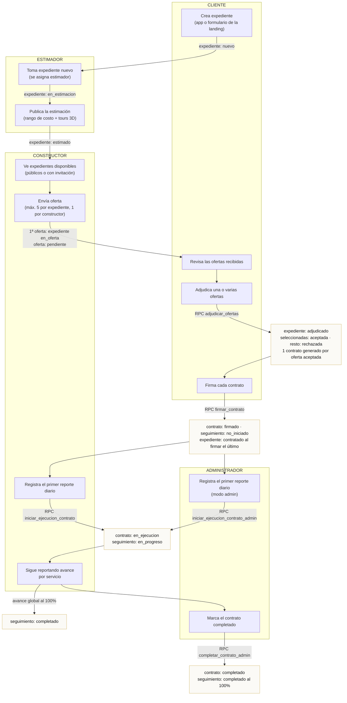
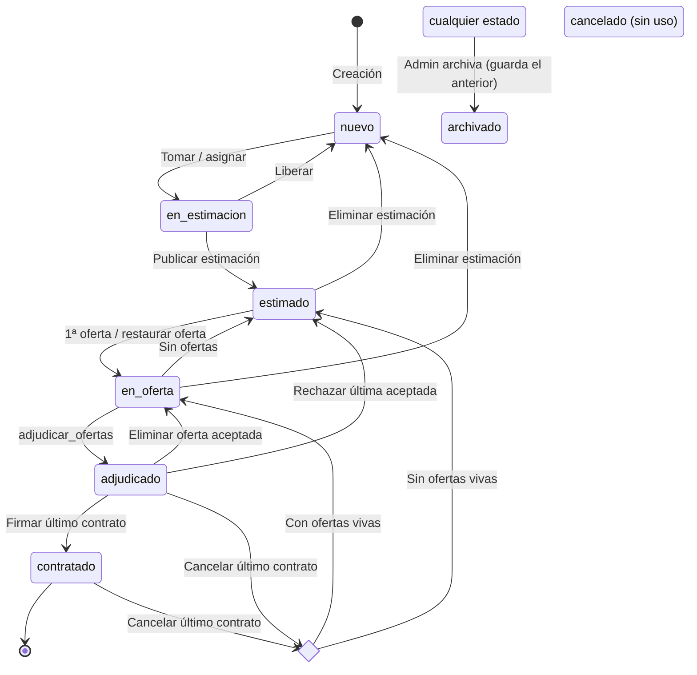
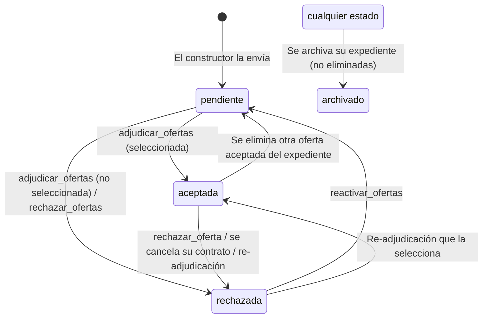
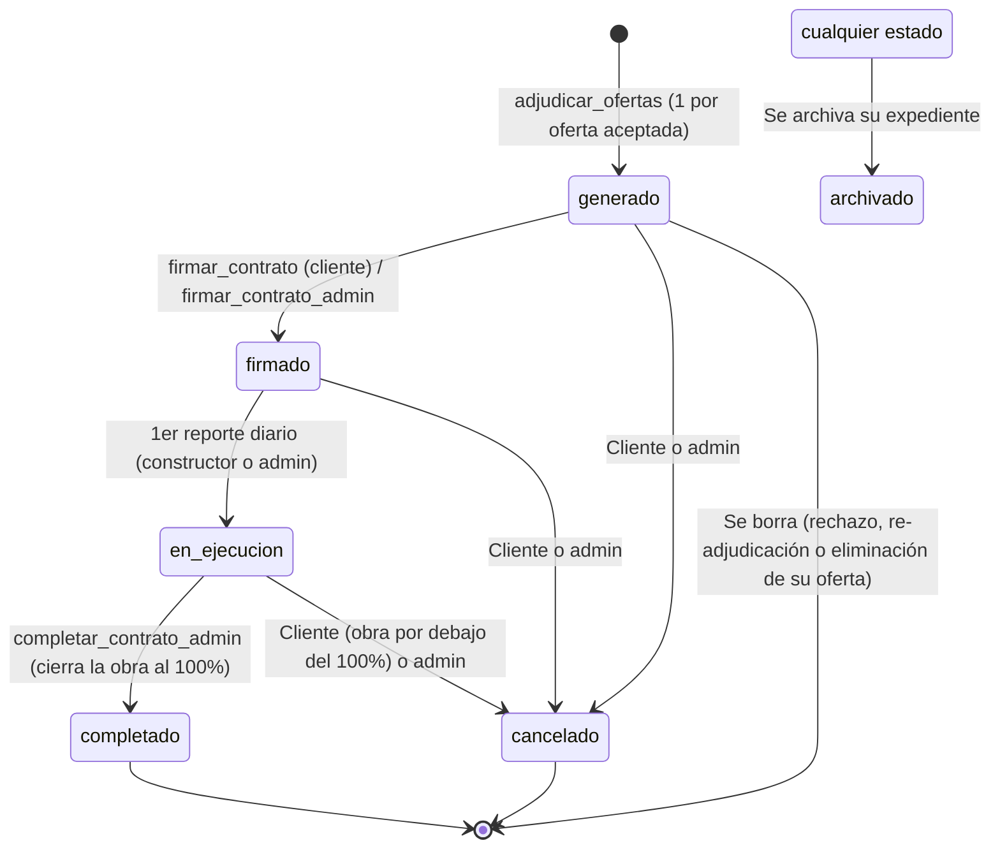
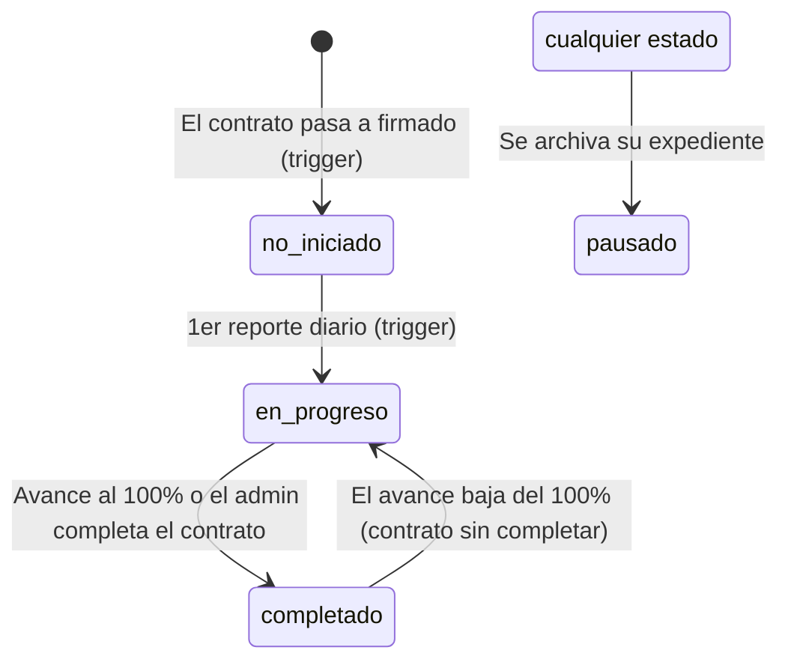

# Flujo del proceso — de la creación del expediente a la obra completada

> Diagramas derivados del código real: estados de los enums (`estado_expediente`,
> `estado_oferta`, `estado_contrato`, `estado_seguimiento`) y las RPCs, triggers
> y servicios que los transicionan.
>
> **Verificado el 2026-11-03 contra las funciones de la base de producción**, no
> solo contra `supabase/migrations/`: las migraciones del repositorio no
> reflejan del todo lo que hay desplegado. Fuentes: funciones y triggers del
> esquema `public`, `src/app/data/*`, `src/app/services/*` y los componentes que
> las llaman.
>
> Incluye `20261103_completar_contrato_cierra_obra.sql` (completar el contrato
> cierra la obra al 100 %), `20261103b/c` (archivar el expediente) y
> `20261103d` (solo el administrador modifica lo archivado), aplicadas en
> producción el 2026-11-03, igual que `20261103e` (desarchivar).
>
> Las fuentes Mermaid de cada diagrama están en [`diagramas/`](./diagramas/).

## Actores

| Rol | Responsabilidad principal |
|-----|---------------------------|
| **Cliente** | Crea el expediente (en la app o desde el formulario de la landing), revisa las ofertas, adjudica una o varias, firma cada contrato y puede cancelarlos. |
| **Estimador** | Toma expedientes nuevos y los estima (rango de costo + tours 3D); puede liberarlos o eliminar la estimación. Las RPC también le permiten gestionar ofertas: adjudicar, rechazar, reactivar, eliminar y restaurar. |
| **Constructor** | Ve los expedientes estimados públicos o a los que fue invitado, envía una oferta por expediente, ejecuta la obra y la reporta. Su primer reporte diario arranca la ejecución del contrato. |
| **Administrador** | Supervisa todo: asigna estimadores, adjudica, firma en nombre del cliente, inicia la ejecución (registrando el primer reporte en modo admin), completa y cancela contratos, elimina o restaura ofertas y archiva expedientes. |

---

## 1. Flujo extremo a extremo

El camino feliz. Las vueltas atrás (liberar, rechazar, cancelar, re-adjudicar)
están en los ciclos de vida de cada entidad, más abajo.

Dos ideas que el diagrama no puede mostrar del todo:

- **Un expediente puede tener varios contratos**, uno por cada oferta aceptada
  (por ejemplo, un constructor para cada servicio). Cada contrato lleva su
  propio seguimiento de obra.
- **La obra puede terminar antes que el contrato, pero no al revés.** El
  seguimiento pasa a `completado` solo, cuando el avance llega al 100 %, y el
  contrato sigue `en_ejecucion` hasta que el administrador lo completa. Al
  completar el contrato, la obra se cierra también: `completado` y 100 %,
  sumen o no tanto los reportes.

---

## 2. Ciclo de vida del **expediente**

| Estado | En la UI | Cómo se llega |
|---|---|---|
| `nuevo` | Nuevo | Lo crea el cliente, un estimador, el administrador o un visitante desde la landing (Edge Function `crear-dossier-landing`). También vuelve aquí al liberarlo o al eliminar su estimación. |
| `en_estimacion` | En revisión | Un estimador lo toma, o el administrador se lo asigna (`asignarEstimador`). |
| `estimado` | Estimado | Se publica la estimación. También vuelve aquí cuando se rechaza la última oferta aceptada, se eliminan todas las ofertas o se cancela el último contrato activo sin que queden ofertas vivas. |
| `en_oferta` | Con ofertas | Automático con la primera oferta (trigger `set_expediente_en_oferta`, solo desde `estimado`) o al restaurar una oferta eliminada. También vuelve aquí al eliminar una oferta aceptada o al cancelar el último contrato activo cuando quedan ofertas vivas. |
| `adjudicado` | Adjudicado | Se adjudican una o varias ofertas (`adjudicar_ofertas`). Se puede re-adjudicar mientras ningún contrato esté firmado. |
| `contratado` | Contratado | Se firma el último contrato `generado` del expediente: mientras quede alguno sin firmar, sigue en `adjudicado`. |
| `cancelado` | Cancelado | **Sin uso:** existe en el enum, pero ninguna RPC ni pantalla lo asigna. |
| `archivado` | Archivado | El administrador lo archiva desde `admin/file/edit`, `admin/to-estimate/edit`, `admin/offer/edit`, `admin/contract/edit` o `admin/construction-monitoring/monitoring` (`archivar_expediente_admin`), desde cualquier estado. Guarda el anterior en `estado_anterior` y la fecha en `archivado_en`. Solo sale con **Desarchivar** en `admin/file/edit` (`desarchivar_expediente_admin`), que lo devuelve a `estado_anterior`. Ver § 6. |

"Ofertas vivas" son las no eliminadas y no rechazadas. "Contratos activos" son
los que están en `generado`, `firmado` o `en_ejecucion`.

---

## 3. Ciclo de vida de la **oferta**

Un constructor ve un expediente cuando este está en `estimado`, `en_oferta`,
`adjudicado` o `contratado` y, además, el expediente es público (nadie ha
enviado invitaciones), el constructor fue invitado o ya había ofertado
(`constructor_puede_ver_expediente`). Cada expediente admite **5 ofertas vivas
como máximo** (trigger `check_max_ofertas_por_expediente`) y **una por
constructor** (índice único `oferta_expediente_constructor_viva_uidx`).

| Estado | En la UI | Cómo se llega |
|---|---|---|
| `pendiente` | Pendiente | El constructor la envía. Vuelve a `pendiente` al reactivarla (`reactivar_ofertas`), al restaurarla si estaba aceptada, o cuando se elimina otra oferta aceptada del mismo expediente. |
| `aceptada` | Aceptada | Queda seleccionada en la adjudicación. Cada oferta aceptada genera un contrato. |
| `rechazada` | Rechazada | No fue seleccionada en la adjudicación, se rechazó (`rechazar_oferta`, `rechazar_ofertas`) o se canceló su contrato. |
| `archivado` | Archivado | Se archivó su expediente. Pasan todas las no eliminadas, con su estado en `estado_anterior`; las eliminadas no se tocan. |

**Borrado lógico.** Aparte del estado, una oferta puede eliminarse
(`eliminar_oferta_admin`, que rellena `eliminada_en`) y restaurarse
(`restaurar_oferta_admin`). Lo hacen el administrador o el estimador. Al
restaurar, una oferta que estaba `aceptada` vuelve como `pendiente`, y se
respetan el máximo de 5 y la regla de una por constructor. Todos estos cambios
quedan registrados en `oferta_auditoria`.

**Reparto en bloque.** `rechazar_ofertas` y `reactivar_ofertas` son solo para el
administrador y el estimador, y la base las bloquea cuando el expediente está
`adjudicado` o `contratado` (`fn_guarda_reparto_ofertas`).

---

## 4. Ciclo de vida del **contrato**

| Estado | Cómo se llega |
|---|---|
| `generado` | Lo crea `adjudicar_ofertas`, uno por oferta aceptada, con el precio, la garantía y la descripción de la oferta. Al re-adjudicar se borran los contratos `generado` y `cancelado` anteriores del expediente. |
| `firmado` | Lo firma el cliente dueño (`firmar_contrato`) o el administrador en su nombre (`firmar_contrato_admin`). Un trigger (`fn_contrato_crea_seguimiento`) crea en ese momento su seguimiento de obra. |
| `en_ejecucion` | La inician **el constructor o el administrador**, y los dos de la misma forma: al guardar el primer reporte diario de un contrato `firmado`, la pantalla de seguimiento llama a `iniciar_ejecucion_contrato` (solo acepta al constructor del contrato) o, en modo admin, a `iniciar_ejecucion_contrato_admin` (solo acepta al administrador). No hay un botón aparte para iniciarla. |
| `completado` | Solo el administrador (`completar_contrato_admin`), desde `admin/contract/edit` o desde el seguimiento en modo admin. Exige `en_ejecucion`, pero no que la obra esté al 100 %: en la misma transacción pone el seguimiento en `completado`, el avance global en 100 % y `fecha_fin_real` (si la obra ya había llegado sola al 100 %, conserva esa fecha). |
| `cancelado` | El cliente (`cancelar_contrato_cliente`), salvo que el contrato esté completado o la obra al 100 %, o el administrador (`cancelar_contrato_admin`). Su oferta pasa a `rechazada`. |
| `archivado` | Se archivó su expediente. Pasan todos, también los completados y los cancelados, con su estado en `estado_anterior`. |

---

## 5. Ciclo de vida del **seguimiento de obra**

Hay un registro `seguimiento_obra` por contrato. Su estado lo mueven los
triggers de `reporte_diario`, `completar_contrato_admin` al cerrar y
`archivar_expediente_admin` al archivar; ninguna pantalla lo cambia
directamente.

| Estado | En la UI | Cómo se llega |
|---|---|---|
| `no_iniciado` | No iniciada | Se crea al firmarse el contrato. |
| `en_progreso` | En progreso | Con el primer reporte diario (`fn_reporte_actualiza_seguimiento`), que además fija `fecha_inicio_real`. Vuelve aquí desde `completado` si el avance baja del 100 %, salvo que el contrato esté completado. |
| `completado` | Completada | Automático cuando el avance global llega al 100 % (`recalcular_avance_seguimiento`), o cuando el administrador completa el contrato (`completar_contrato_admin`), que fija el avance en 100 %. En los dos casos fija `fecha_fin_real`. Con el contrato completado ya no sale de aquí. |
| `pausado` | En pausa | Se archivó su expediente (`archivar_expediente_admin`); el estado previo queda en `estado_anterior`. Con el contrato archivado no admite partes ni recalcula el avance. |

**Cómo se calcula el avance.** Cada reporte diario declara un `% de avance del
día` para un servicio. El acumulado de cada servicio es la suma de sus
reportes, con tope de 100. El avance global es la **media del acumulado de
todos los servicios del contrato**; un servicio sin reportes cuenta 0. Se
recalcula al crear, modificar o borrar cualquier reporte. Con el contrato
`completado` el global queda fijo en 100 %; el acumulado de cada reporte se
sigue recalculando.

---

## 6. Archivo del expediente

El administrador archiva un expediente con el botón **Archivar**, arriba a la
derecha de `admin/file/edit`, `admin/to-estimate/edit`, `admin/offer/edit`,
`admin/contract/edit` y `admin/construction-monitoring/monitoring` (las cinco
usan `shared/ui/archivar-expediente`). Desde el contrato y la obra se archiva el
expediente entero, no solo ese contrato. La RPC `archivar_expediente_admin` hace todo en una
transacción y guarda el estado previo de cada registro en `estado_anterior`,
para poder restaurarlo al desarchivar (ver más abajo):

| Registro | Pasa a |
|---|---|
| Expediente | `archivado` (+ `archivado_en`) |
| Ofertas no eliminadas | `archivado` |
| Contratos, en cualquier estado | `archivado` |
| Seguimientos de obra | `pausado` |

**Solo desarchivar lo reactiva.** Unos triggers de guardia impiden entrar en
`archivado` o salir de él fuera de las RPC de archivar y desarchivar
(`fn_guardia_archivado`), crear ofertas o contratos
en un expediente archivado (`fn_guardia_expediente_archivado`), y crear o
modificar partes, o cambiar el estado o el avance de la obra, con el contrato
archivado (`fn_guardia_reporte_archivado`, `fn_guardia_seguimiento_archivado`).
Así, cualquier RPC que lo intente (cancelar, adjudicar, firmar, completar…)
falla entera. `recalcular_avance_seguimiento` no toca una obra de contrato
archivado. Las dos RPC se identifican ante las guardias con el ajuste local
`app.archivo = 'on'`.

**Solo el administrador lo modifica** (`20261103d`). Con el expediente
archivado, ningún otro usuario puede crear, modificar ni borrar nada que
cuelgue de él: el expediente y su localización, servicios, estimación,
invitaciones y modelos Matterport; sus ofertas y contratos; el seguimiento de
obra con sus partes, actividades, zonas e inspecciones; y los archivos
adjuntos. Lo impide un trigger por tabla (`trg_archivado_solo_admin` →
`fn_guardia_archivado_solo_admin`). El administrador sí puede editar datos,
pero las guardias de arriba siguen valiendo también para él: no cambia
estados, no crea ofertas ni contratos y no registra partes. Las pantallas de
cliente y estimador esconden o desactivan esas acciones en un archivado.

**Desarchivar** (`20261103e`). En `admin/file/edit`, con el expediente
archivado, el mismo botón de arriba a la derecha pasa a **Desarchivar** (misma
confirmación, `shared/ui/archivar-expediente` con `[accion]="'desarchivar'"`).
La RPC `desarchivar_expediente_admin`, solo administrador y en una transacción,
devuelve cada registro a su `estado_anterior` y lo deja a NULL:

| Registro | Vuelve a |
|---|---|
| Expediente | su `estado_anterior` (borra `archivado_en`) |
| Ofertas archivadas | su `estado_anterior` |
| Contratos archivados | su `estado_anterior` |
| Seguimientos de obra pausados por el archivo | su `estado_anterior` |

Falla entera si el expediente no está archivado o si a alguno le falta el
estado anterior. Mientras estuvo archivado nada pudo cambiar de estado, así que
queda exactamente como estaba (probado ida y vuelta sobre los dos archivados
de producción, sin diferencias). El avance de las obras no se recalcula: los
partes no se pudieron tocar. Si un contrato vuelve a `firmado`,
`trg_contrato_seguimiento` salta pero no duplica la obra
(`on conflict (contrato_id) do nothing`). El expediente sale de
`admin/archived` y vuelve a los listados normales.

**Listados.** Los archivados no aparecen en `admin/file`, `admin/to-estimate`,
`admin/offer`, `admin/contract` ni `admin/construction-monitoring/list`. Tienen
su propia lista, `admin/archived` (menú «Archivados»), con el estado que
tenían al archivarse el expediente y cada uno de sus contratos; cada fila abre
`admin/file/edit`, que también muestra, en cada contrato archivado, el estado
al que volverá («Al archivar: …»).

**Avisos.** Cliente y constructores ven el aviso «Expediente archivado: los
trabajos no se realizarán. Solo un administrador puede modificarlo» en el
expediente, las ofertas, los contratos y el seguimiento de obra (componente
`app-aviso-archivado`), y un aviso emergente en el momento
(`realtime.exp_archivado`, `realtime.ofe_archivado`).

---

## Resumen de transiciones (estado ↔ disparador)

| # | Acción (actor) | Mecanismo | Expediente | Oferta | Contrato | Seguimiento |
|---|----------------|-----------|------------|--------|----------|-------------|
| 1 | Crear expediente (cliente, estimador, admin o visitante de la landing) | insert en `expediente` / Edge Function `crear-dossier-landing` | → `nuevo` | — | — | — |
| 2 | Tomar o asignar (estimador / admin) | UPDATE directo `asignarEstimador` | → `en_estimacion` | — | — | — |
| 3 | Liberar (estimador / admin) | UPDATE directo `liberar` | → `nuevo`, sin estimador | — | — | — |
| 4 | Publicar estimación (estimador / admin) | UPDATE directo `updateEstado` | → `estimado` | — | — | — |
| 5 | Eliminar estimación (estimador) | UPDATE directo `updateEstado` | `estimado`/`en_oferta` → `nuevo` | — | — | — |
| 6 | Enviar oferta (constructor) | insert en `oferta` + trigger `set_expediente_en_oferta` | `estimado` → `en_oferta` | → `pendiente` | — | — |
| 7 | Adjudicar (cliente dueño, admin o estimador) | RPC `adjudicar_ofertas` | → `adjudicado` | seleccionadas `aceptada`, resto `rechazada` | borra `generado`/`cancelado` previos; crea uno `generado` por aceptada | — |
| 8 | Rechazar o reactivar en bloque (admin / estimador; no en `adjudicado`/`contratado`) | RPC `rechazar_ofertas` / `reactivar_ofertas` | — | → `rechazada` / `rechazada` → `pendiente` | — | — |
| 9 | Rechazar una oferta aceptada (cliente, admin o estimador; contrato sin firmar) | RPC `rechazar_oferta` | → `estimado` si no queda ninguna aceptada | `aceptada` → `rechazada` | se borra | — |
| 10 | Eliminar oferta (admin / estimador) | RPC `eliminar_oferta_admin` | → `en_oferta` si era aceptada; → `estimado` si no quedan ofertas | `eliminada_en`; si era aceptada, las demás → `pendiente` | se borra el `generado` de esa oferta | — |
| 11 | Restaurar oferta (admin / estimador) | RPC `restaurar_oferta_admin` | `estimado` → `en_oferta` | sin `eliminada_en`; `aceptada` → `pendiente` | — | — |
| 12 | Firmar (cliente / admin) | RPC `firmar_contrato` / `firmar_contrato_admin` | → `contratado` cuando no queda ninguno `generado` | — | `generado` → `firmado` | se crea `no_iniciado` |
| 13 | Primer reporte diario (constructor o administrador) | insert en `reporte_diario` + RPC `iniciar_ejecucion_contrato` (constructor) / `iniciar_ejecucion_contrato_admin` (admin) | — | — | `firmado` → `en_ejecucion` | `no_iniciado` → `en_progreso` |
| 14 | Reportar avance (constructor) | insert/update/delete en `reporte_diario` + `recalcular_avance_seguimiento` | — | — | — | → `completado` al 100 %; vuelve a `en_progreso` si baja (no con el contrato completado) |
| 15 | Completar (admin) | RPC `completar_contrato_admin` | — | — | `en_ejecucion` → `completado` | → `completado`, avance 100 %, `fecha_fin_real` |
| 16 | Cancelar contrato (cliente, salvo completado u obra al 100 %; admin) | RPC `cancelar_contrato_cliente` / `cancelar_contrato_admin` | si no quedan contratos activos: → `en_oferta` (con ofertas vivas) o `estimado` | su oferta → `rechazada` | → `cancelado` | sin cambio |
| 17 | Archivar (admin) | RPC `archivar_expediente_admin` | → `archivado` (guarda el anterior) | no eliminadas → `archivado` | todos → `archivado` | → `pausado` |
| 18 | Desarchivar (admin, `admin/file/edit`) | RPC `desarchivar_expediente_admin` | `archivado` → `estado_anterior` | archivadas → `estado_anterior` | archivados → `estado_anterior` | pausados por el archivo → `estado_anterior` |

---

## Huecos y comportamientos a revisar

Salen de leer las funciones desplegadas. No son decisiones documentadas: hay
que confirmar si son intencionales.

1. **Estado sin uso.** `expediente.cancelado` existe y la UI lo muestra, pero
   nada lo asigna. (`seguimiento_obra.pausado` sí se usa desde que existe el
   archivo.)
2. **Los pasos 2 a 5 no los valida la base.** Son UPDATE directos desde el
   navegador, y la política `expediente_update` deja a estimadores y
   administradores escribir cualquier estado, sin comprobar el orden.
3. **Cancelar no cuenta los contratos completados.** Al cancelar el último
   contrato activo, el expediente vuelve a `en_oferta` o `estimado` aunque otro
   contrato del mismo expediente esté `completado`.
4. **Eliminar una oferta aceptada afecta a todas las demás.**
   `eliminar_oferta_admin` pone en `pendiente` todas las demás ofertas vivas y
   el expediente en `en_oferta`, sin mirar si hay otros contratos ya firmados
   (caso de adjudicación múltiple). Además, solo borra el contrato de esa
   oferta si está `generado`.
5. **`cancelar_contrato_admin` no comprueba el estado del contrato**: puede
   cancelar un contrato `completado`.
6. **Completados anteriores a `20261103_completar_contrato_cierra_obra.sql`.**
   Hay 3 contratos `completado` cuyo seguimiento sigue en `no_iniciado` al 0 %
   y sin `fecha_fin_real`; la UI los enmascara mostrando 100 % cuando el
   contrato está completado (`src/app/services/obra-vm.service.ts`), pero los
   paneles de constructor y administrador leen el valor guardado. La pantalla
   de seguimiento ya no deja crear ni borrar reportes de un contrato completado
   o cancelado, pero la política `reporte_write` sí lo permite por API.
7. **La política `oferta_insert` no mira el estado del expediente.** La UI solo
   ofrece ofertar en `estimado`/`en_oferta`, pero por API un constructor podría
   ofertar en un expediente `adjudicado` o `contratado`.
8. **RPC heredadas que el frontend ya no llama:** `aceptar_oferta`,
   `aceptar_seleccion_ofertas`, `cancelar_contrato` y `marcar_contratado`. El
   método `restoreEstadoEstimado` de `oferta.repository.ts` tampoco tiene
   llamadas.
