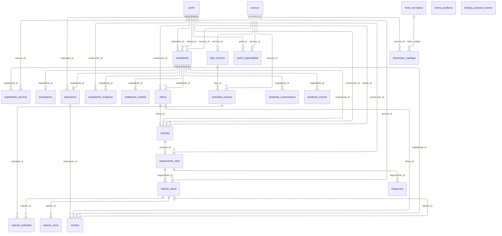
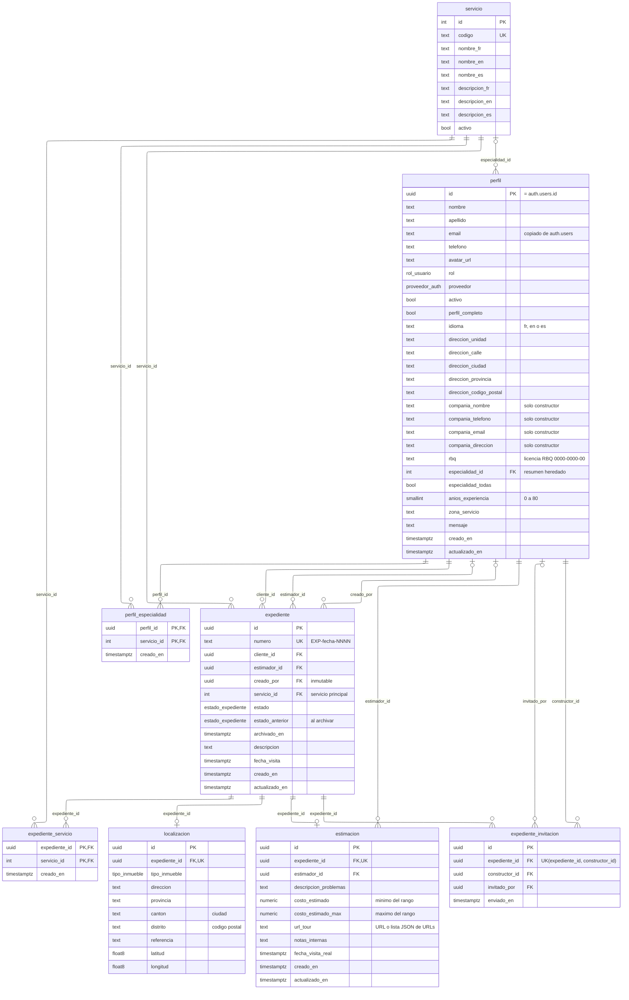
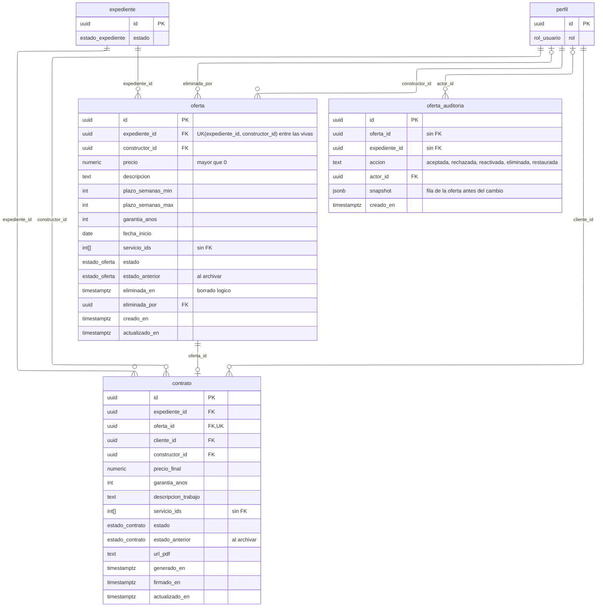
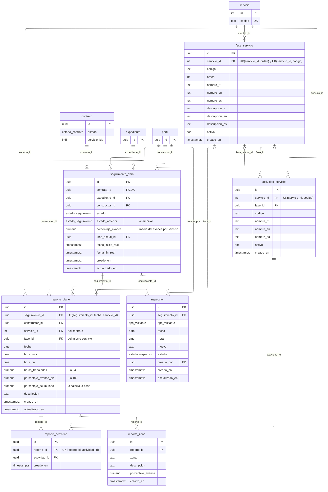
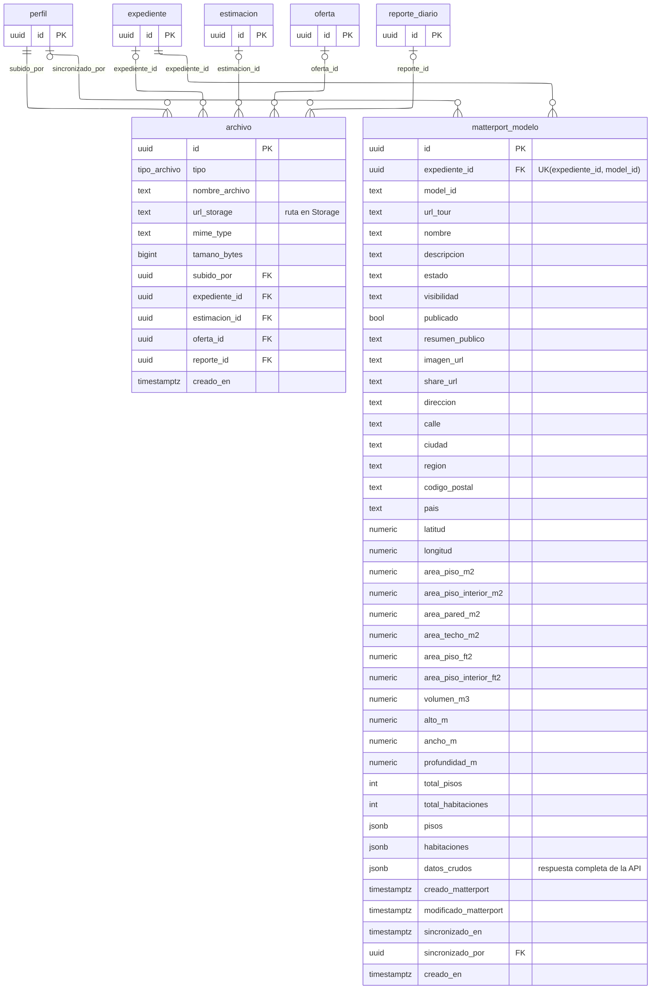
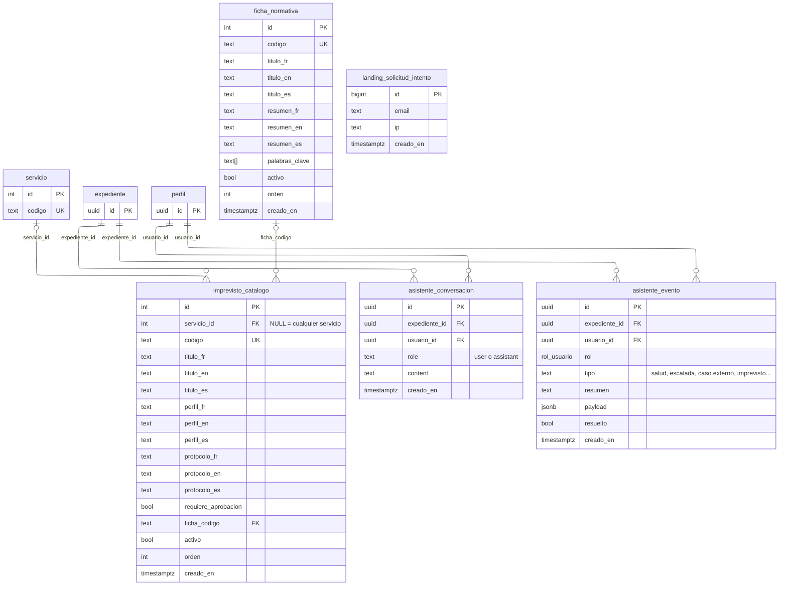

# Modelo de datos — base de datos de Estimation3D

> Esquema `public` de Supabase (PostgreSQL 17): **26 tablas, 1 vista, 53 claves
> foráneas y 10 enums**.
>
> **Extraído el 2026-11-03 de la base de producción**, no de
> `supabase/migrations/`: las migraciones del repositorio no contienen el
> esquema base. Incluye las columnas y valores del archivo de expedientes
> (`20261103b_estado_archivado`). Los tipos exactos y la nulabilidad de cada columna están en
> [`src/app/types/supabase.ts`](../src/app/types/supabase.ts); el ciclo de vida
> de los estados, en [`FLUJO_PROCESO.md`](./FLUJO_PROCESO.md).
>
> Las fuentes Mermaid están en [`diagramas/`](./diagramas/) (`bd-*.mmd`), junto
> con su versión en PNG y SVG.

## Cómo leer los diagramas

| Notación | Significado |
|---|---|
| `\|\|` | exactamente uno |
| `\|o` | cero o uno (la clave foránea admite `NULL`) |
| `o{` | cero o muchos |
| `o\|` en el lado hijo | cero o uno (la clave foránea es única: relación 1 a 1) |
| `PK` / `FK` / `UK` | clave primaria / foránea / única |
| `UK(a, b)` en un comentario | unicidad compuesta de esas columnas |
| "sin FK" | la columna guarda ids de otra tabla, pero sin clave foránea |

Las etiquetas de las relaciones son el nombre de la columna que hace de clave
foránea.

---

## Visión general

Todas las tablas y las relaciones de negocio. Para que se pueda leer, omite las
relaciones de autoría y auditoría con `perfil` (`creado_por`, `subido_por`,
`invitado_por`, `eliminada_por`, `sincronizado_por`, `actor_id`, `usuario_id`) y
las columnas redundantes (`seguimiento_obra.expediente_id`, `fase_actual_id`,
`reporte_diario.fase_id`, `perfil.especialidad_id`). Están todas en los
diagramas por dominio.

`perfil` es el centro del modelo: un mismo registro es cliente, estimador,
constructor o administrador según `perfil.rol`. Su `id` es el de
`auth.users` (1 a 1, con borrado en cascada).

---

## 1. Usuarios y expedientes

| Tabla | Para qué sirve |
|---|---|
| `perfil` | Datos de cada usuario, su rol y si está activo. Los datos de compañía y profesionales (RBQ, especialidades, experiencia) solo se rellenan para constructores. |
| `perfil_especialidad` | Servicios que cubre cada constructor. `perfil.especialidad_todas` = cubre todos (excluyente con la lista). |
| `servicio` | Catálogo de servicios (moho, amianto, renovación…), con nombre en los tres idiomas. |
| `expediente` | La solicitud del cliente: un inmueble, un servicio principal, una visita y un estado. |
| `expediente_servicio` | Todos los servicios del expediente. Un trigger añade aquí siempre el servicio principal. |
| `localizacion` | Dirección del inmueble (una por expediente). |
| `estimacion` | El informe del estimador (una por expediente): problemas, rango de costo y tours 3D. |
| `expediente_invitacion` | Constructores invitados a ofertar. Si un expediente tiene invitaciones, solo esos constructores lo ven. |

---

## 2. Ofertas y contratos

| Tabla | Para qué sirve |
|---|---|
| `oferta` | Propuesta de un constructor para un expediente. Máximo 5 vivas por expediente y una por constructor. `servicio_ids` = servicios que cubre (un trigger exige que sean del expediente). |
| `oferta_auditoria` | Historial de cada cambio de estado o borrado de una oferta, con la fila completa en `snapshot`. No tiene FK a propósito, para que el historial sobreviva al borrado. |
| `contrato` | Uno por oferta aceptada. Copia el precio, la garantía y los servicios de la oferta al crearse. |

---

## 3. Seguimiento de obra

| Tabla | Para qué sirve |
|---|---|
| `seguimiento_obra` | La obra de un contrato (uno por contrato, se crea al firmarlo). Guarda el estado y el avance global. |
| `reporte_diario` | El parte diario del constructor: un servicio, una fase y el % de avance del día. Como máximo uno por día y servicio. |
| `reporte_actividad` | Actividades del catálogo marcadas como hechas en el parte. |
| `reporte_zona` | Avance por zona del inmueble dentro del parte. |
| `inspeccion` | Visitas programadas a la obra (inspector, dueño o estimador). |
| `fase_servicio` | Fases ordenadas de cada servicio (catálogo). |
| `actividad_servicio` | Actividades de cada servicio, opcionalmente agrupadas por fase (catálogo). |

---

## 4. Archivos y Matterport

| Tabla | Para qué sirve |
|---|---|
| `archivo` | Metadatos de cada fichero subido a Storage (fotos, vídeos, documentos, PDF de contrato, adjuntos de reportes). Cuelga de un expediente, una estimación, una oferta o un reporte. |
| `matterport_modelo` | Copia de los datos de un modelo 3D de Matterport (medidas, pisos, habitaciones), sincronizada por la Edge Function `matterport-sync`. |

---

## 5. Catálogos de referencia, asistente IA y landing

| Tabla | Para qué sirve |
|---|---|
| `ficha_normativa` | Fichas de normativa de Quebec que el asistente IA usa como fuente de referencia. |
| `imprevisto_catalogo` | Imprevistos conocidos por servicio, con su protocolo y la ficha normativa asociada. También es fuente de referencia del asistente. |
| `asistente_conversacion` | Historial del chat con el asistente IA, por usuario y expediente. |
| `asistente_evento` | Eventos internos que registra el asistente (salud mencionada, escalada humana, caso externo, imprevistos). El usuario no los ve; el administrador los revisa en `admin/ai-events`. |
| `landing_solicitud_intento` | Registro de los envíos de los formularios públicos, para el límite por correo e IP. Se purga a los 7 días y solo la escribe el service role. |

---

## Enums

| Enum | Valores |
|---|---|
| `rol_usuario` | `cliente`, `estimador`, `constructor`, `administrador` |
| `proveedor_auth` | `email`, `google` |
| `estado_expediente` | `nuevo`, `en_estimacion`, `estimado`, `en_oferta`, `adjudicado`, `contratado`, `cancelado`, `archivado` |
| `estado_oferta` | `pendiente`, `aceptada`, `rechazada`, `archivado` |
| `estado_contrato` | `generado`, `firmado`, `en_ejecucion`, `completado`, `cancelado`, `archivado` |
| `estado_seguimiento` | `no_iniciado`, `en_progreso`, `pausado`, `completado` |
| `estado_inspeccion` | `programada`, `realizada`, `cancelada` |
| `tipo_visitante` | `inspector`, `dueno`, `estimador` |
| `tipo_archivo` | `foto`, `video`, `documento`, `contrato_pdf`, `reporte_foto`, `reporte_video`, `reporte_documento` |
| `tipo_inmueble` | `casa`, `apartamento`, `edificio`, `local_comercial`, `otro` |

## Vista

`expediente_busqueda` une `expediente` con su `localizacion` para buscar por
dirección. Usa `security_invoker`, así que respeta las políticas RLS de quien
consulta.

---

## Reglas que no se ven en el diagrama

- **Arrays de servicios sin FK.** `oferta.servicio_ids` y
  `contrato.servicio_ids` guardan ids de `servicio` sin clave foránea. Los
  protegen triggers: `fn_oferta_servicios` exige que sean servicios del
  expediente (y, si no se indican, pone todos) y `fn_contrato_servicios` los
  copia de la oferta al crear el contrato.
- **Servicio principal duplicado a propósito.** `expediente.servicio_id` es el
  principal y `expediente_servicio` la lista completa; un trigger
  (`fn_expediente_servicio_principal`) mete siempre el principal en la lista.
- **Coherencia del reporte diario.** `fn_reporte_servicio` exige que el
  servicio del reporte sea uno del contrato y que la fase pertenezca a ese
  servicio.
- **`perfil.especialidad_id` es un resumen heredado.** La lista real está en
  `perfil_especialidad`; esa columna guarda el único servicio elegido, o `NULL`
  si hay varios, para lecturas antiguas.
- **Archivo del expediente.** `archivar_expediente_admin` pasa el expediente,
  sus ofertas no eliminadas y todos sus contratos a `archivado`, y sus
  seguimientos a `pausado`; en cada fila guarda el estado previo en
  `estado_anterior` (y la fecha en `expediente.archivado_en`).
  `desarchivar_expediente_admin` (migración `20261103e`) lo deshace: cada fila
  vuelve a su `estado_anterior`, que queda a NULL, y `archivado_en` se borra.
  Lo protegen triggers de guardia:
  `fn_guardia_archivado` (nadie entra en `archivado` ni sale de él fuera de esas
  dos RPC, que se identifican con el ajuste local `app.archivo = 'on'`),
  `fn_guardia_expediente_archivado` (no se crean ofertas ni contratos en un
  expediente archivado), `fn_guardia_reporte_archivado` (no se crean ni
  modifican partes de un contrato archivado; borrarlos sí) y
  `fn_guardia_seguimiento_archivado` (no cambia el estado ni el avance de su
  obra). Además, `fn_guardia_archivado_solo_admin` (trigger
  `trg_archivado_solo_admin` en las 14 tablas del expediente; migración
  `20261103d`) impide a cualquier usuario que no sea
  administrador crear, modificar o borrar filas de un expediente archivado;
  `fn_expediente_de_fila` averigua a qué expediente pertenece cada fila. El
  ciclo completo está en [`FLUJO_PROCESO.md`](./FLUJO_PROCESO.md) § 6.
- **Nombres de dirección heredados.** En `localizacion`, `canton` guarda la
  ciudad y `distrito` el código postal.
- **Qué pasa al borrar:**
  - Borrar un expediente arrastra en cascada su localización, estimación,
    ofertas, archivos, invitaciones, conversaciones y seguimientos, **pero no
    se puede si tiene contratos** (`contrato.expediente_id` es `NO ACTION`).
    Lo mismo pasa con una oferta que tenga contrato.
  - El `perfil` se borra en cascada con su usuario de `auth.users`, pero
    casi todas las FK hacia `perfil` son `NO ACTION`: un usuario con
    expedientes, ofertas o contratos no se puede borrar sin limpiar antes.
    Para eso existen los scripts de
    [`scripts/borrado-usuario/`](../scripts/borrado-usuario/).
